# Ferramentas IARHA para o EPANET 2.2 Brasil — Manual de uso

## Sumário

1. [Apresentação](#apresentação)
2. [O que vem no pacote](#o-que-vem-no-pacote)
3. [Requisitos](#requisitos)
4. [Instalação](#instalação)
5. [Como cadastrar uma ferramenta no EPANET](#como-cadastrar-uma-ferramenta-no-epanet)
6. [Cadastro das sete ferramentas](#cadastro-das-sete-ferramentas)
7. [Usando cada ferramenta](#usando-cada-ferramenta)
8. [Personalizando o relatório](#personalizando-o-relatório)
9. [Como funciona por dentro](#como-funciona-por-dentro)
10. [Solução de problemas](#solução-de-problemas)
11. [Criando suas próprias ferramentas](#criando-suas-próprias-ferramentas)
12. [Validação, limitações e créditos](#validação-limitações-e-créditos)

## Apresentação

As Ferramentas IARHA acrescentam sete funções ao menu **Ferramentas** do EPANET 2.2 Brasil. Com um clique, você obtém o resumo da rede, a verificação do cadastro, a alteração de rugosidade em lote, a checagem de pressões e velocidades pela NBR 12218 e dois relatórios técnicos com mapas, sem sair do programa.

Tudo parte do EPANET. As ferramentas não substituem nenhuma função dele: usam o próprio motor de cálculo do EPANET 2.2 Brasil e só organizam os resultados em formatos prontos para análise e entrega.

**Para quem:** projetistas, operadores de sistemas de abastecimento e estudantes que já usam o EPANET 2.2 Brasil.

**Créditos:** o EPANET foi desenvolvido pela U.S. Environmental Protection Agency (USEPA). A versão brasileira, com tradução e o menu Ferramentas usado aqui, é do Laboratório de Eficiência Energética e Hidráulica em Saneamento da UFPB ([LENHS/UFPB](https://www.ct.ufpb.br/lenhs/downlodas/epanet/)).

**Como ler este manual:** quem só quer usar pode seguir as seções de Requisitos a Usando cada ferramenta. As seções finais explicam os cálculos, resolvem problemas comuns e mostram como criar ferramentas novas.

## O que vem no pacote

O pacote é uma pasta única, `epanet_br_tools`, com sete ferramentas, os módulos de apoio e uma rede de demonstração.

| # | Ferramenta | Arquivo | O que faz | Altera o projeto? |
| --- | --- | --- | --- | --- |
| 1 | Resumo da Rede | `01_resumo_rede.py` | Quantitativos, extensão por diâmetro e por rugosidade | Não |
| 2 | Verificador de Consistência | `02_verificar_consistencia.py` | Aponta erros de cadastro antes de simular | Não |
| 3 | Rugosidade em Lote | `03_rugosidade_lote.py` | Define ou multiplica a rugosidade por faixa de diâmetro | **Sim** (grava backup `.bak`) |
| 4 | Pressões e Velocidades NBR 12218 | `04_pressoes_nbr12218.py` | Lista nós e trechos fora dos limites no período simulado | Não |
| 5 | Relatório de Diagnóstico | `05_relatorio_iarha.py` | Relatório A4 com capa, síntese, mapa de pressões e anexo | Não |
| 6 | Relatório de Análise da Rede | `06_relatorio_analise_rede.py` | Painel completo com indicadores, histogramas, reservação, Top 10, diagnóstico e 6 mapas temáticos | Não |
| 7 | Configurar Relatório | `07_configurar_relatorio.py` | Janela para personalizar o relatório da ferramenta 6 | Não |

Arquivos de apoio na mesma pasta, que precisam ficar junto das ferramentas:

- `epanet_comum.py` — leitura e gravação do INP, leitura dos resultados e simulação
- `config_relatorio.py` — janela e arquivo de configuração do relatório
- `fontes/` — fontes Bebas Neue e Fira Sans Condensed usadas no relatório 6, com as licenças
- `rede_demo.inp` — rede pequena para testar e para a prévia da configuração
- `Cadastro_Ferramentas_EPANET_Br.xlsx` — planilha que monta os campos do cadastro com os seus caminhos
- `config_relatorio.json` — criado na primeira vez que você salva a configuração

## Requisitos

Você precisa de três coisas: Windows, o EPANET 2.2 Brasil e o Python 3 instalado a partir do python.org.

| Item | Detalhe |
| --- | --- |
| Windows | 10 ou 11 |
| EPANET 2.2 Brasil | Disponível na [página do LENHS/UFPB](https://www.ct.ufpb.br/lenhs/downlodas/epanet/). Instala em `C:\Program Files (x86)\Epanet 2.2 Brasil` e traz o `runepanet.exe`, que as ferramentas 4, 5 e 6 usam para simular |
| Python 3.10 ou mais novo | O instalador oficial do [python.org](https://www.python.org/downloads/windows/) já traz tudo o que as ferramentas usam, inclusive o `tkinter` das janelas. Não é preciso instalar nenhum pacote extra |
| Navegador | Qualquer um. Os relatórios abrem no navegador padrão e podem ser salvos em PDF |

Não use o Python da Microsoft Store (o atalho em `WindowsApps`). Ele pode não abrir pelo EPANET.

## Instalação

A instalação leva uns 10 minutos e só precisa ser feita uma vez por computador.

1. **Instale o Python.** Baixe o instalador do [python.org](https://www.python.org/downloads/windows/). Na primeira tela, marque **"Add python.exe to PATH"** e clique em Install Now.
2. **Descubra o caminho do `pythonw.exe`.** Abra o PowerShell e digite:

    ```
    where.exe pythonw
    ```

    Use o primeiro caminho que aparecer, por exemplo `C:\Users\seu.usuario\AppData\Local\Programs\Python\Python312\pythonw.exe`. Ignore o que estiver em `WindowsApps`. No PowerShell digite `where.exe`, com o ".exe": sem ele, o comando é outro e não mostra nada.
3. **Copie o conteúdo da pasta `epanet_br_tools`** para um caminho curto, sem acentos e fora do OneDrive. Recomendado: `C:\EPANET_Ferramentas`. Os arquivos `.py` ficam diretamente dentro dela, junto com a subpasta `fontes`.
4. **Cadastre as ferramentas no EPANET**, como explicado nas duas próximas seções.
5. **Teste com a rede de demonstração.** Abra `rede_demo.inp` no EPANET e rode o Resumo da Rede. Deve abrir no navegador um relatório com 4,13 km de rede e 17 L/s de demanda.

## Como cadastrar uma ferramenta no EPANET

Cada ferramenta é cadastrada uma vez em **Ferramentas › Configurar Ferramentas › Adicionar**. A regra que evita quase todos os erros: no campo **Programa** vai sempre o `pythonw.exe`, e o arquivo `.py` vai em **Parâmetros**.

| Campo da janela | O que colocar |
| --- | --- |
| Nome da Ferramenta | O nome que aparecerá no menu, por exemplo `Relatório de Análise` |
| Programa (arq. executável) | O caminho completo do `pythonw.exe` (Instalação, passo 2) |
| Pasta de Trabalho | A pasta das ferramentas, por exemplo `C:\EPANET_Ferramentas` |
| Parâmetros | O caminho do script **entre aspas**, um espaço e `$INPFILE`. Exemplo: `"C:\EPANET_Ferramentas\06_relatorio_analise_rede.py" $INPFILE` |
| Desativar o Epanet durante a execução | Desmarcado |
| Atualizar o Epanet após finalizar o programa | Marcado **só** na Rugosidade em Lote (ferramenta 3) |

**Opções de Entrada.** O EPANET 2.2 Brasil oferece três códigos que ele troca pelo caminho real na hora de rodar. Para inserir um deles, clique nele na lista e depois no botão vermelho **+**.

- `$INPFILE` — o projeto aberto, gravado num arquivo temporário, inclusive com alterações ainda não salvas. É o que as ferramentas usam.
- `$PROJDIR` — a pasta do projeto.
- `$RPTFILE` — o relatório de texto do EPANET.

Não existe `$OUTFILE` na versão brasileira. Por isso as ferramentas 4, 5 e 6 simulam sozinhas, com o motor do próprio EPANET Br, e não é preciso rodar a simulação antes.

**Cuidado ao copiar e colar.** Confira se a linha de Parâmetros começa com aspas, fecha as aspas depois do `.py` e não termina com uma crase ou aspas sobrando.

## Cadastro das sete ferramentas

Com a pasta em `C:\EPANET_Ferramentas`, os campos Programa e Pasta de Trabalho são iguais nas sete ferramentas. Só mudam os Parâmetros e a opção de atualizar.

| # | Nome sugerido | Parâmetros | Atualizar após finalizar |
| --- | --- | --- | --- |
| 1 | Resumo da Rede | `"C:\EPANET_Ferramentas\01_resumo_rede.py" $INPFILE` | Não |
| 2 | Verificador de Consistência | `"C:\EPANET_Ferramentas\02_verificar_consistencia.py" $INPFILE` | Não |
| 3 | Rugosidade em Lote | `"C:\EPANET_Ferramentas\03_rugosidade_lote.py" $INPFILE` | **Sim** |
| 4 | Pressões NBR 12218 | `"C:\EPANET_Ferramentas\04_pressoes_nbr12218.py" $INPFILE 10 40 0.4 3.5` | Não |
| 5 | Relatório de Diagnóstico | `"C:\EPANET_Ferramentas\05_relatorio_iarha.py" $INPFILE 10 40 0.4 3.5` | Não |
| 6 | Relatório de Análise da Rede | `"C:\EPANET_Ferramentas\06_relatorio_analise_rede.py" $INPFILE` | Não |
| 7 | Configurar Relatório | `"C:\EPANET_Ferramentas\07_configurar_relatorio.py"` | Não |

**Os números depois de `$INPFILE`** nas ferramentas 4 e 5 são, nesta ordem: pressão mínima (mca), pressão máxima (mca), velocidade mínima (m/s) e velocidade máxima (m/s). Se omitidos, valem 10, 40, 0,4 e 3,5. Aceitam ponto ou vírgula decimal.

**Na ferramenta 6** os critérios vêm da janela de configuração (ferramenta 7). Se você escrever números depois de `$INPFILE`, eles têm prioridade: pressão mínima, máxima, velocidade mínima, máxima e K1.

O pacote traz a planilha `Cadastro_Ferramentas_EPANET_Br.xlsx`. Nela você troca o caminho do Python e da pasta uma vez, e as sete linhas saem prontas para copiar.

## Usando cada ferramenta

Com o projeto aberto, escolha a ferramenta no menu **Ferramentas**. As de relatório abrem uma página no navegador; a Rugosidade em Lote abre uma janela e devolve o projeto alterado ao EPANET.

**Para guardar um relatório:** o arquivo HTML fica na pasta temporária do Windows e é substituído na próxima execução. Para manter, clique em **Imprimir / salvar PDF**, escolha "Salvar como PDF", papel A4, margens padrão e marque **Gráficos de fundo**.

### 1 · Resumo da Rede

Mostra os quantitativos do projeto: nós, reservatórios, tubulações, bombas, válvulas, extensão total, demanda base e faixa de cotas, mais a extensão por diâmetro e por coeficiente de rugosidade. Não precisa simular.

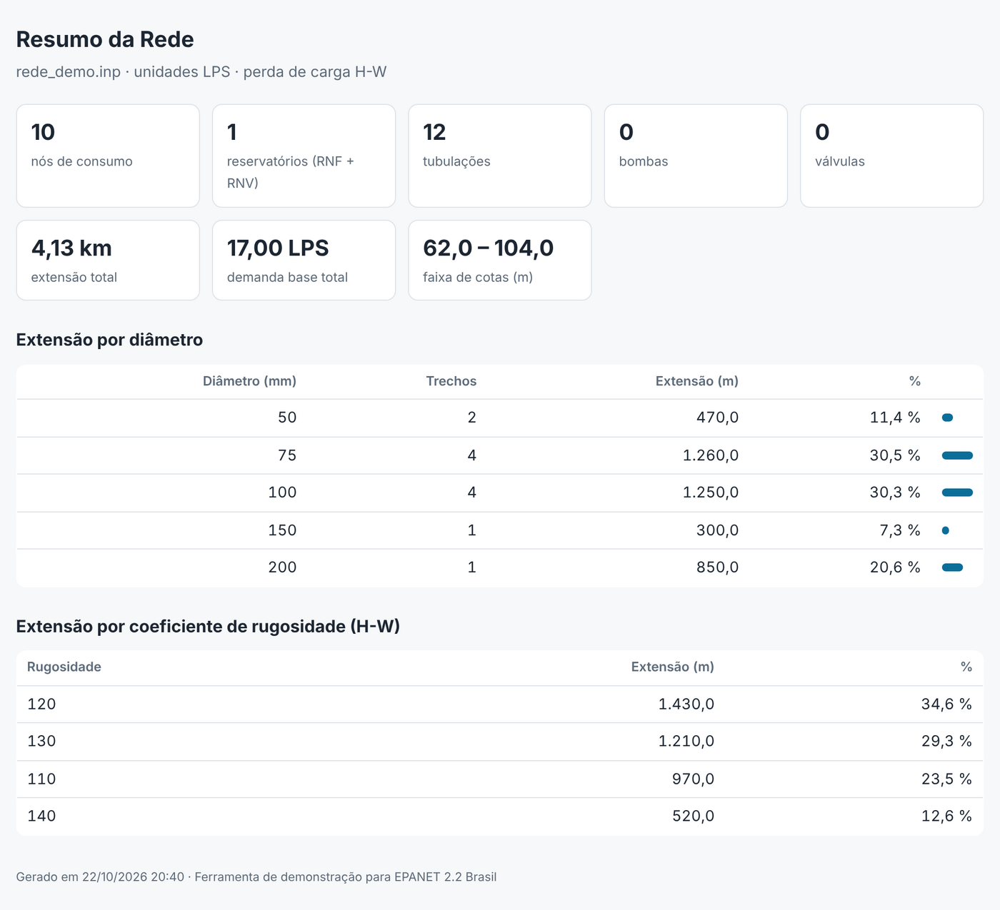

### 2 · Verificador de Consistência

Aponta problemas de cadastro antes de simular, separados em **erros** (impedem um resultado correto) e **avisos** (merecem conferência):

- ID de nó repetido, rede sem reservatório ou tanque
- trecho ligado a um nó que não existe, trecho com início e fim no mesmo nó
- comprimento ou diâmetro zero ou negativo, trecho com menos de 1 m
- rugosidade fora da faixa usual da fórmula (Hazen-Williams 40 a 150; Darcy-Weisbach 0 a 10 mm; Manning 0,008 a 0,035)
- nó sem nenhum trecho, nó com cota zero, nó sem coordenada
- nó sem caminho até um reservatório (considera tubos fechados)

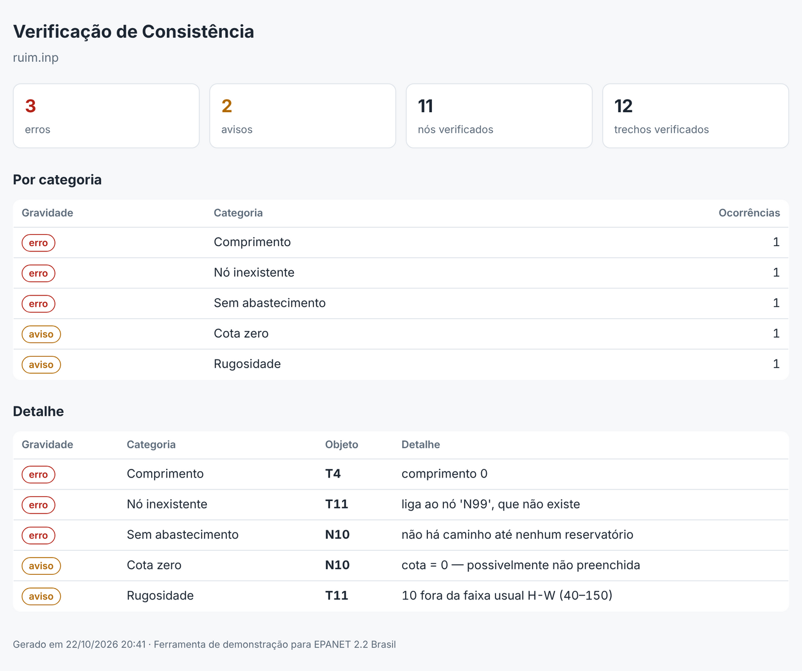

### 3 · Rugosidade em Lote

Altera a rugosidade de todas as tubulações numa faixa de diâmetro. Na janela, informe o diâmetro mínimo e máximo, a operação e o valor:

- **definir** — todas as tubulações da faixa passam a ter o valor informado (ex.: C = 100)
- **multiplicar** — o coeficiente atual é multiplicado pelo valor (ex.: 0,9 reduz 10%)

Ao clicar em **Aplicar**, o EPANET recarrega o projeto já alterado. Para manter a mudança, salve o projeto normalmente; para desfazer, feche o projeto sem salvar. Esta ferramenta precisa de **Atualizar o Epanet após finalizar o programa** marcado no cadastro.

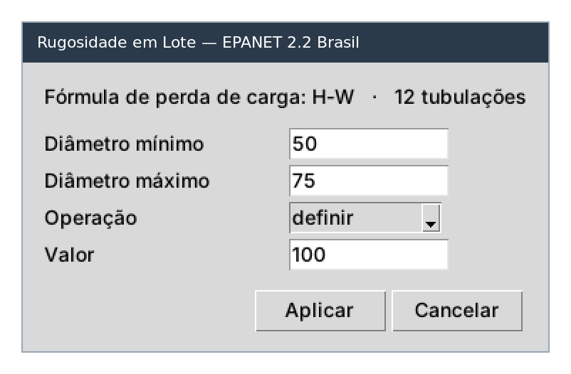

### 4 · Pressões e Velocidades NBR 12218

Simula o projeto e lista, para todo o período simulado, os nós com pressão mínima abaixo do limite, os nós com pressão máxima acima do limite e os trechos com velocidade fora da faixa, com a hora em que cada caso ocorre. A pressão máxima simulada é usada como aproximação da pressão estática.

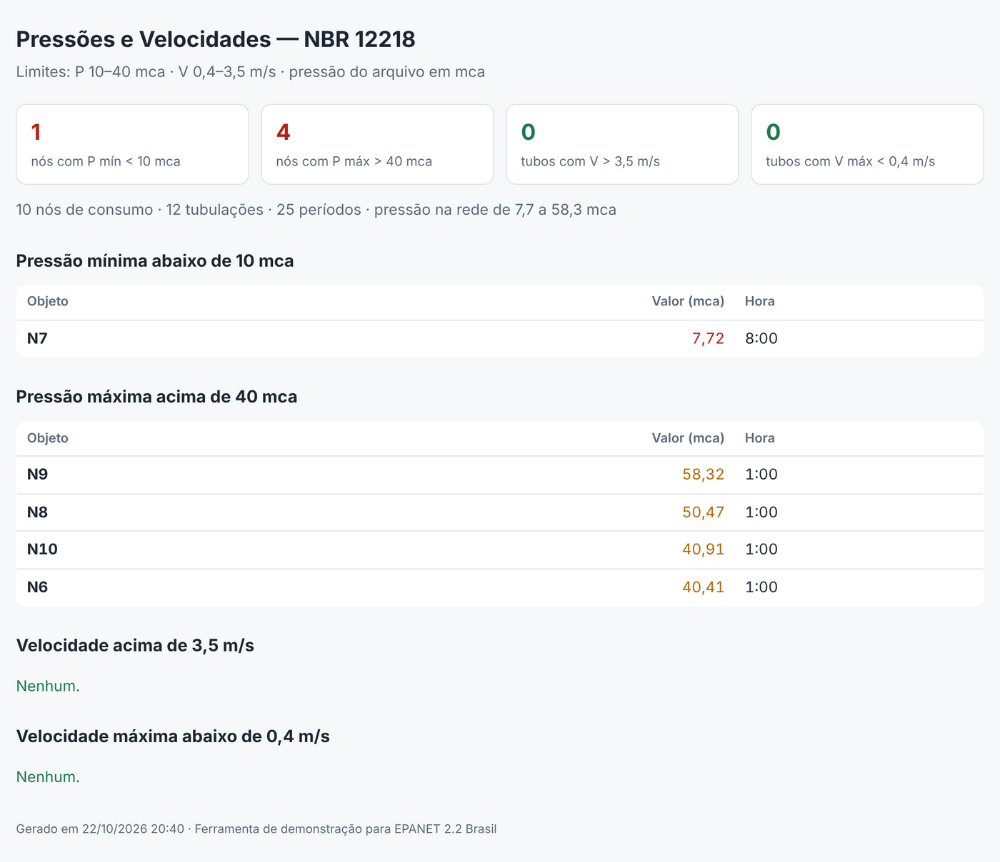

### 5 · Relatório de Diagnóstico

Gera um relatório A4 com capa, síntese escrita automaticamente, caracterização da rede, mapa de pressões, gráficos de pressão e velocidade, consistência do cadastro e anexo com a pressão de cada nó. Para usar o seu logo na capa, coloque `logo_iarha.png` ou `logo_iarha.svg` na pasta das ferramentas.

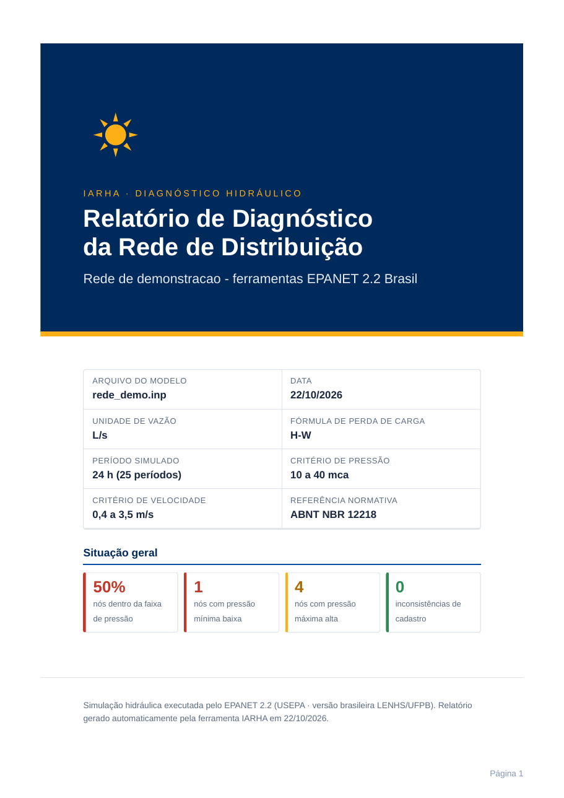

### 6 · Relatório de Análise da Rede

É o relatório mais completo, no padrão visual do IARHA-ATLAS. Traz, nesta ordem:

1. Topologia: trechos, nós, extensão, reservatórios e tanques, VRPs e bombas
2. Pressão nos nós: média, mínima, máxima, quantos nós estão fora dos limites e quantos km de rede ficam acima da pressão máxima
3. Hidráulica dos trechos: perda de carga média, km com perda alta, km com velocidade fora da faixa, elevações
4. Demandas: nós com demanda, demanda base, consumo no pico e consumo médio
5. Distribuições em km de rede: pressão, perda de carga, elevação e diâmetro
6. Balanço do sistema: reservatórios + tanques → consumo, no pico
7. Capacidade de reservação pelo critério de 1/3 do volume do dia de maior consumo (e 1/5 para comparação)
8. Top 10 de maior perda de carga, menor pressão e maior pressão
9. Diagnóstico automático com selos Crítico, Atenção e Ok
10. Seis mapas temáticos: pressão, perda de carga, velocidade, demanda, elevação e diâmetro

Todos os valores são convertidos para unidades SI (m, mm, mca, L/s, m/s, m/km), mesmo que o projeto esteja em unidades americanas. Cada seção informa o horário da simulação que está sendo mostrado.

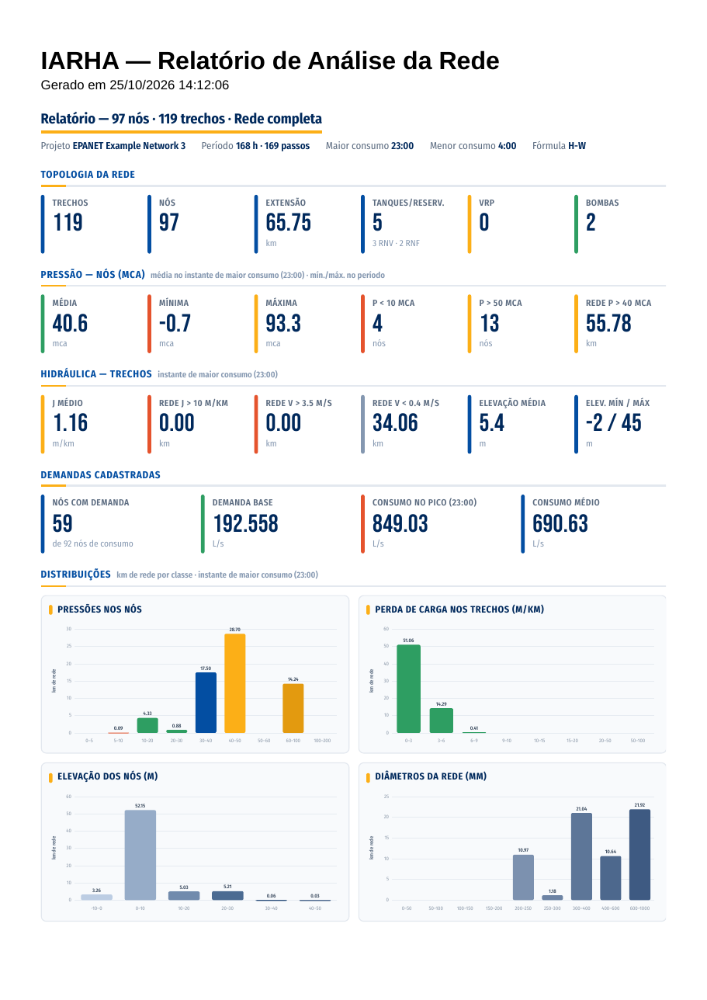

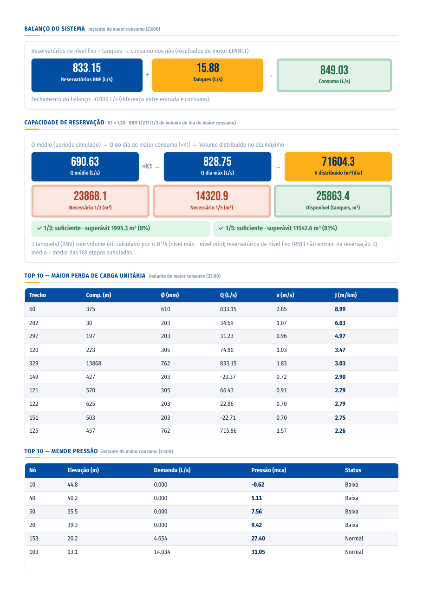

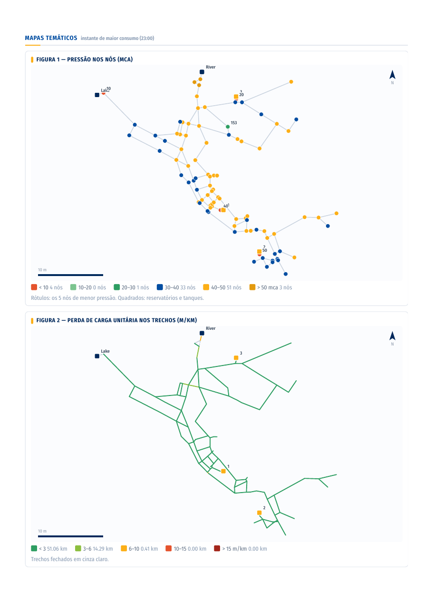

### 7 · Configurar Relatório

Abre a janela de personalização do relatório 6, explicada na próxima seção. Não usa o projeto aberto.

## Personalizando o relatório

A ferramenta 7 abre uma janela com cinco abas. O que você salvar ali vale para todos os próximos Relatórios de Análise da Rede (ferramenta 6) e fica gravado em `config_relatorio.json`, na pasta das ferramentas.

| Aba | O que se ajusta |
| --- | --- |
| Geral | Título, subtítulo (empresa, cliente, sistema), responsável técnico, logo (PNG, JPG ou SVG), separador decimal (ponto ou vírgula) |
| Critérios | Pressão mínima, pressão máxima, pressão alta (alerta de VRP), velocidade mínima e máxima, perda de carga alta, K1 |
| Cores | As sete cores do relatório: primária, destaque, realce, situação boa, situação crítica, alerta forte e neutra |
| Mapas | Uma sub-aba por mapa. Pressão, perda de carga e velocidade: limites e cor de cada classe. Demanda, elevação e diâmetro: cor inicial e final da rampa. Em todos: incluir ou não o mapa |
| Seções | Quais das dez partes do relatório entram |

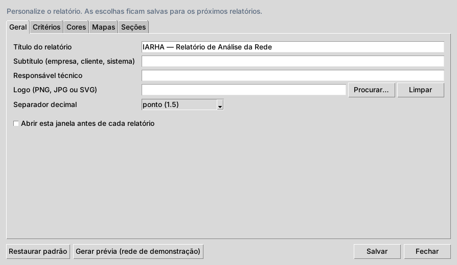

**Classes de um mapa.** Digite os limites separados por ponto e vírgula, por exemplo `10; 25; 40`, e clique em **Atualizar classes**. A janela cria uma classe a mais que o número de limites (abaixo de 10, 10 a 25, 25 a 40, acima de 40) e mostra uma cor para cada uma. Clique no quadrado colorido ou em **Escolher…** para abrir a paleta, ou digite o código hex (`#RRGGBB`).

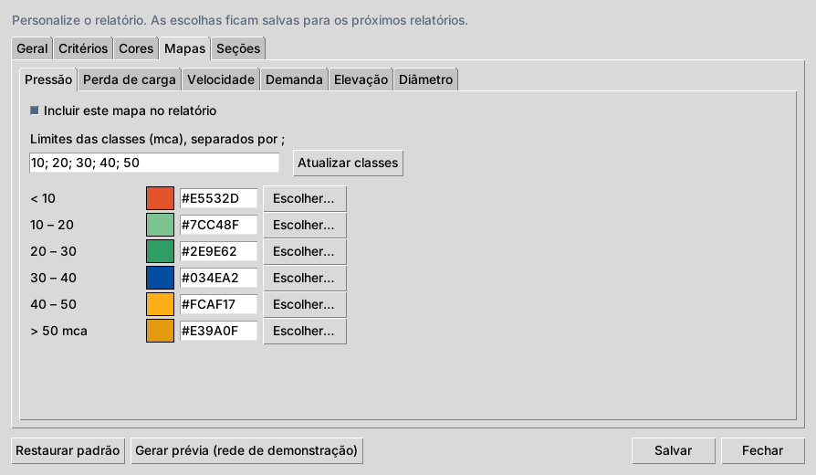

**Botões da janela:**

- **Gerar prévia** — abre o relatório da rede de demonstração com as escolhas da tela, sem salvar nada
- **Salvar** — grava as escolhas para os próximos relatórios
- **Restaurar padrão** — volta tudo ao visual IARHA original

**Perguntar antes de cada relatório.** Na aba Geral, a opção "Abrir esta janela antes de cada relatório" faz a ferramenta 6 mostrar a janela antes de gerar, com os botões **Gerar relatório** e **Cancelar**. Útil para trocar título ou cliente a cada projeto.

**Compartilhar um padrão visual.** Para que a equipe use o mesmo visual, copie o seu `config_relatorio.json` para a pasta das ferramentas de cada computador. Se o logo estiver fora dessa pasta, copie o logo também e ajuste o caminho na aba Geral.

## Como funciona por dentro

Ao escolher uma ferramenta, o EPANET grava o projeto aberto num INP temporário e chama o Python com esse caminho no lugar de `$INPFILE`. O script lê o INP, chama o motor do EPANET Br quando precisa de resultados e abre o relatório no navegador.

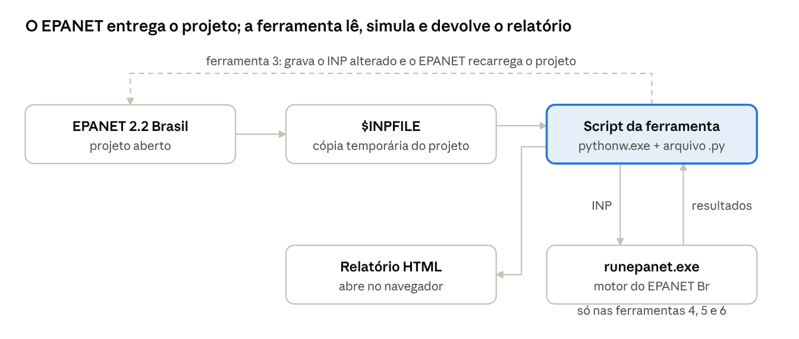

**Premissas de cálculo dos relatórios:**

- **Instante analisado.** Os indicadores hidráulicos usam o passo de **maior consumo** da simulação. A pressão máxima e o Top 10 de maior pressão usam o passo de **menor consumo**. Cada seção informa o horário usado.
- **Envelope do período.** Pressão mínima e máxima de cada nó consideram todos os passos simulados.
- **km de rede.** Cada tubulação entra no histograma com o seu comprimento. Pressão e elevação de um trecho são a média dos dois nós, ignorando reservatórios e tanques.
- **Perda de carga unitária.** Vem direto do motor, em m/km. O "J médio" é a média ponderada pelo comprimento dos tubos abertos.
- **Balanço do sistema.** Saída dos reservatórios + contribuição dos tanques = consumo nos nós, no passo de maior consumo. A diferença mostrada deve ficar perto de zero.
- **Reservação.** Q médio = média do consumo em todos os passos. Volume do dia de maior consumo = Q médio × K1 × 86,4 (m³/dia, com Q em L/s). Necessário = 1/3 desse volume; o relatório também mostra 1/5 para comparação.
- **Unidades.** Tudo é convertido para SI. Projetos em unidades americanas (gpm, psi, ft) aparecem em L/s, mca e m.

## Solução de problemas

Quase todos os problemas vêm do cadastro da ferramenta. Para ver a mensagem de erro, troque `pythonw.exe` por `python.exe` no campo Programa: abre uma janela preta que mostra o que aconteceu.

| O que acontece | Causa | Como resolver |
| --- | --- | --- |
| Abre o VS Code ou o Bloco de Notas com o código | O campo Programa aponta para o `.py` | Programa = `pythonw.exe`; o `.py` vai em Parâmetros |
| Nada acontece | Caminho do script errado ou aspas faltando em Parâmetros | Confira a pasta e as aspas: `"C:\...\script.py" $INPFILE` |
| "Arquivo não encontrado — $INPFILE não existe" | Caminho com espaço cortado (`C:\Users\Nome`) numa versão antiga | Use a versão atual do pacote, que remonta o caminho sozinha |
| "could not convert string to float" | Caractere sobrando num número, como uma crase copiada junto | Apague o caractere em Parâmetros; a versão atual já ignora |
| "I/O error 32" ao clicar OK no cadastro | Outro programa está com a lista de ferramentas (`%APPDATA%\EPANET\Epanet2Tools.ini`) aberta | Feche todas as janelas de EPANET, inclusive de outras versões instaladas, e cadastre de novo |
| "Não encontrei o runepanet.exe" | EPANET Br instalado fora de `C:\Program Files (x86)\Epanet 2.2 Brasil` | Copie o `runepanet.exe` da pasta do EPANET Br para a pasta das ferramentas |
| "A simulação não terminou" | Erro no modelo, como nó isolado ou rede sem reservatório | A mensagem traz o erro do EPANET; rode o Verificador ou simule pelo próprio EPANET |
| A janela de configuração ou de rugosidade não abre | Python instalado sem o tcl/tk | Reinstale o Python marcando "tcl/tk and IDLE" |
| "O projeto não tem coordenadas — mapa indisponível" | Rede sem a seção `[COORDINATES]` | Os mapas precisam das coordenadas dos nós |
| Relatório 6 com fontes diferentes | Pasta `fontes` ausente | Copie a pasta `fontes` junto com os scripts |
| `where pythonw` não mostra nada | No PowerShell, `where` é outro comando | Digite `where.exe pythonw` |

## Criando suas próprias ferramentas

Uma ferramenta nova é um script Python que recebe `$INPFILE` e usa o módulo `epanet_comum.py`. Basta salvar o arquivo na pasta das ferramentas e cadastrá-lo como as outras. Use só a biblioteca padrão do Python, para que funcione em qualquer computador sem instalações extras.

Exemplo completo, testado: lista os nós de consumo sem demanda base (não considera a seção `[DEMANDS]`).

```python
# 08_nos_sem_demanda.py — Parâmetros: "<pasta>\08_nos_sem_demanda.py" $INPFILE
import os, sys
sys.path.insert(0, os.path.dirname(os.path.abspath(__file__)))
from epanet_comum import Inp, arg_arquivo, gravar_relatorio, tabela_html, esc

inp = Inp(arg_arquivo(1, "$INPFILE"))
sem = [t[0] for t in inp.tabela("JUNCTIONS") if len(t) < 3 or float(t[2]) == 0]
corpo = "<p>%d nós de consumo sem demanda base.</p>" % len(sem)
corpo += tabela_html(["Nó"], [[esc(n)] for n in sem])
gravar_relatorio("Nós sem demanda", os.path.basename(inp.caminho), corpo, "nos_sem_demanda.html")
```

O que o `epanet_comum.py` oferece:

| Função ou classe | Para que serve |
| --- | --- |
| `arg_arquivo(1, "$INPFILE")` | Devolve o caminho do projeto, remontando caminhos com espaço que chegam partidos |
| `Inp(caminho)` | Lê o INP mantendo cada linha. `tabela("PIPES")` devolve os campos de uma seção; `opcao("UNITS")` lê uma opção; `unidades_si()` e `formula()` informam unidades e perda de carga |
| `Inp.linhas`, `Inp.secoes`, `substituir_campo()`, `Inp.salvar()` | Alteram campos sem perder comentários, acentos e quebras de linha; `salvar()` grava um backup `.bak`. Use com "Atualizar o Epanet após finalizar" marcado |
| `simular(caminho_inp)` | Roda o `runepanet.exe` do EPANET Br e devolve o arquivo de resultados `.out` |
| `SaidaBinaria(caminho_out)` | Lê os resultados: `nos`, `links`, `cotas`, `diametros`, `nperiodos`, `periodo(k)`, `completo(k)` (demanda, carga, pressão, vazão, velocidade, perda de carga, status) e `hora(k)` |
| `gravar_relatorio(titulo, subtitulo, corpo, arquivo)` | Grava o HTML com o estilo das ferramentas e abre no navegador |
| `tabela_html()`, `fmt()`, `esc()`, `numeros()`, `avisar()` | Tabela HTML, número em formato brasileiro, texto seguro em HTML, parâmetros numéricos tolerantes e caixa de mensagem |

Os resultados do `.out` vêm na unidade do projeto. A pressão pode estar em psi, kPa, mca ou bar: veja o dicionário `CONV_P` nas ferramentas 4 e 6 para converter.

Quer compartilhar a sua ferramenta? Abra um **Pull Request** neste repositório.

## Validação, limitações e créditos

Os números das ferramentas foram conferidos contra cálculos independentes em três redes de teste: a rede de demonstração (10 nós), a Net3 do EPANET (92 nós, bombas e tanques, unidades americanas) e uma rede de 935 nós.

- Os indicadores da ferramenta 6 na Net3 bateram com a biblioteca WNTR (USEPA/Sandia): consumo no pico 849,03 L/s, consumo médio 690,63 L/s, pressão mínima −0,7 e máxima 93,3 mca, perda de carga média 1,16 m/km. A pressão média deu 40,6 contra 40,7 mca, por arredondamento na conversão de psi.
- A Rugosidade em Lote preserva acentos, codificação, comentários e quebras de linha do INP, e o arquivo alterado volta a simular.

**Limitações conhecidas:**

- Os relatórios refletem o modelo e os dados de entrada. Calibração e validação de campo são responsabilidade do projetista.
- A pressão máxima simulada é uma aproximação da pressão estática. Para a verificação estrita, simule o cenário de consumo mínimo.
- O volume disponível dos tanques é calculado como cilindro: π·D²/4 × (nível máximo − nível mínimo). Tanques com curva de volume são aproximados pelo diâmetro.
- Os mapas são desenhados a partir das coordenadas do INP, sem imagem de fundo.
- A maior rede testada tinha 935 nós. Redes muito grandes funcionam, mas o HTML fica mais pesado.

**Créditos e licenças:**

- **EPANET** — U.S. Environmental Protection Agency (USEPA), domínio público. **EPANET 2.2 Brasil** — [LENHS/UFPB](https://www.ct.ufpb.br/lenhs/downlodas/epanet/).
- **Fontes do relatório 6** — Bebas Neue (The Bebas Neue Project Authors) e Fira Sans Condensed (Mozilla Foundation e Telefonica S.A.), ambas sob a SIL Open Font License 1.1. As licenças completas estão na pasta `fontes`.
- **Ferramentas IARHA** — Álvaro Prestes Ribeiro e LUGH Engenharia Ambiental e Sanitária, licença [MIT](../LICENSE).
- **Dúvidas e sugestões** — pelas Issues do repositório no GitHub.
